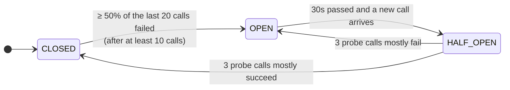
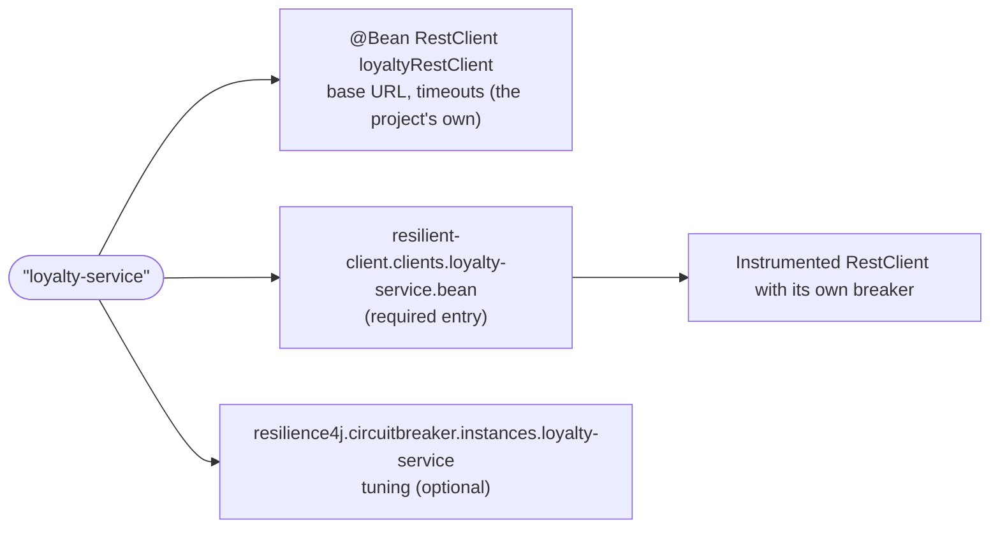

# prototype-integrations: resilient REST clients and error handling

A standalone prototype of two things meant for the cc-auth rewrite:

1. A reusable, low-ceremony **circuit breaker** for every outbound `RestClient`.
2. One **error-handling pattern** that replaces per-call `try/catch` ladders.

Clients are ordinary `RestClient` beans. Every bean listed under `resilient-client.clients` in YAML is instrumented at startup, with no per-client code. It gets:

- a Resilience4j breaker applied by a `ClientHttpRequestInterceptor` (on by default),
- one `FailureClassifier` that decides both the breaker outcome and the exception type,
- optionally (`error-handling.enabled: true`), a single translation and logging point that produces a small sealed exception hierarchy.

Stack: Java 25, Spring Boot 4.1.1 (Framework 7), Apache HttpClient5, Resilience4j 2.4.0 (`resilience4j-spring-boot4`), WireMock (`wiremock-spring-boot`) in tests.

```bash
./gradlew test --console=plain -q   # unit + integration tests, no Docker needed
./gradlew bootRun                    # starts on :8080; the downstreams are placeholder localhost URLs
```

The integration tests are the demo. With `bootRun` and nothing listening on the downstream ports, every call returns the 502 below. That is still enough to watch `/actuator/circuitbreakers`, `/actuator/health` and `/actuator/metrics/downstream.failures`.

## Package layout

| Package (`io.pipecrafts.prototype.integration.*`) | Role |
|---|---|
| `client` | `ResilientClientProperties` (the `resilient-client.*` YAML), `ResilientClientInstrumenter`, `ResilientClients` (`forClient(name)`), `ResilientClientCustomizer`, `ClientPolicyResolver`, `ResilientClientsValidator`, `ResilientClientAutoConfiguration`, `CircuitBreakerInterceptor`, `DownstreamFailureInterceptor` |
| `failure` | Single source of truth for classification: `FailureClassifier` (+ `DefaultFailureClassifier`), categories and reasons, `ErrorBodyParser`, the sealed exceptions, `CircuitOpenIOException`, status handler, translator, `DownstreamFailureLog` |
| `call` | `Downstream.call(...)`, the facade helper |
| `web` | `ApiExceptionHandler`, `ApiProblems` (ProblemDetail factory), `ApiErrorCode` |
| `demo.*` | Four demo downstreams, each with a client class, a facade, a controller and records. `DemoClientsConfiguration` defines their plain `RestClient` beans (the profile one backed by a generated OpenAPI client) |

Dependencies point one way: `demo` → `call`/`failure`/`web`, and `client` → `failure`. The reusable packages never import `demo`.

## Failure taxonomy

Every downstream outcome lands in exactly one category. Statuses are classified by **one** `FailureClassifier`, which both the breaker and the status handler consult, so they can't disagree. I/O failures are always `DEPENDENCY_FAILURE`.

| Category | Triggers (default) | Breaker records | Surfaces as | API response |
|---|---|---|---|---|
| `SUCCESS` | 2xx | success | normal return | 200 |
| `BUSINESS` | 4xx except 401/403/408/429 (400, 404, 409, 422, ...) | **success**: the dependency is healthy | `DownstreamBusinessException` with the parsed `DownstreamError(code, message)` | facade's own code, else 422 `DOWNSTREAM_REJECTED` |
| `DEPENDENCY_FAILURE` | 5xx, 408, 429, any `IOException` (timeout, refused, reset, DNS), open circuit, undecodable 2xx body, 1xx and unfollowed 3xx | **failure** | `DependencyFailedException` | 502 `DEPENDENCY_FAILED` |
| `DEPENDENCY_REJECTED` | 401, 403 | **ignored** by default (configurable per client) | `DependencyFailedException(reason = UNAUTHORIZED)` | 502 `DEPENDENCY_FAILED` |

Internal reasons, which only ever appear in logs and metrics: `SERVER_ERROR`, `TIMEOUT`, `CONNECTION_FAILED`, `CIRCUIT_OPEN`, `UNAUTHORIZED`, `THROTTLED`, `MALFORMED_RESPONSE`.

**Why 401/403 fold into the 502.** A 401/403 means *our* credentials or configuration are wrong. The customer can't fix that, so it must look exactly like an outage to the caller. It still gets a distinct `UNAUTHORIZED` reason at WARN plus a metric tag, so a bad deploy or rotated secret is alertable and never mistaken for a business outcome.

**Why 401/403 are ignored by the breaker by default.** A credentials fault says nothing about whether the dependency is up. Counting it as a failure would open the breaker on a config error. Counting it as a success would dilute a real outage happening at the same time. So the permission is released and nothing is recorded. A client can opt into "count as failure" (see escape hatch 2).

Exceptions form a sealed hierarchy: `DownstreamException` permits `DependencyFailedException` and `DownstreamBusinessException`. Both carry `dependency`, `operation` and `httpStatus()` (empty for I/O failures). `reason` lives on `DependencyFailedException` only. Exception messages are built from those fields alone and never include bodies, headers or URLs.

## Circuit breaker at a glance

> Full walkthrough with more diagrams, a per-client customization table and a "where to look in the code" map: **[docs/circuit-breaker.md](docs/circuit-breaker.md)**.

Each client gets its own breaker, named after the client. The breaker only counts **dependency failures**; business 4xx count as success and 401/403 aren't counted at all.



While **OPEN**, every call fails fast with 502 `DEPENDENCY_FAILED` (`reason=CIRCUIT_OPEN`) and nothing reaches the network. Thresholds come from `resilience4j.circuitbreaker.configs.default` and can be tuned per client.

**Reusing it is one YAML entry.** A `RestClient` bean listed under `resilient-client.clients` is protected; there is no breaker code in clients or facades:



See [Adding a fifth downstream](#adding-a-fifth-downstream) for the code and the [Escape-hatch cookbook](#escape-hatch-cookbook) for per-client tweaks.

## Call pipeline and ordering

```
Facade ── client.getProfile(id) ── restClient.get().uri("/profiles/{id}", id).retrieve().body(...)
  RestClient
   ├─ the project's own interceptors (outermost)
   │   └─ DownstreamFailureInterceptor        (only when error-handling.enabled)
   │        IOException -> DependencyFailedException (TIMEOUT / CONNECTION_FAILED / CIRCUIT_OPEN), logged once
   │       └─ interceptors added by ResilientClientCustomizer beans
   │           └─ CircuitBreakerInterceptor   (innermost, always added last)
   │                OPEN?  -> throw CircuitOpenIOException (never touches the wire)
   │                else   -> execute, buffer the whole body, classify the raw status,
   │                          record success / failure / ignored with duration
   │                    └─ HttpClient5 (automatic retries disabled) ── wire ── downstream
   └─ DownstreamStatusHandler   (runs AFTER the chain returns; matches every status)
        same classifier -> no-op | DownstreamBusinessException | DependencyFailedException, logged once
```

Rules:

- **The breaker is innermost.** `ResilientClients.forClient` adds it after error handling and the customizers have run.
- **The breaker never relies on handler exceptions.** It sees raw statuses and raw `IOException`s. The status handler runs later, inside `RestClient`, on the buffered response.
- **Translation and logging happen exactly once**, in the failure interceptor (I/O) or the status handler (statuses). Facades never log downstream failures. RestClient rethrows runtime exceptions from interceptors unchanged, so callers never see a `ResourceAccessException`.
- **The body is fully buffered inside the breaker.** Measured duration therefore includes body transfer, so slow-call thresholds mean something, and a mid-body timeout is counted by the breaker. Streaming or large-payload clients should set `circuit-breaker.enabled: false`.
- **HttpClient5's automatic retry is disabled** (in the demo's own `RestClient` config, since transport is the project's concern). Otherwise it silently resends 429/503 after one second regardless of HTTP method, POSTs included. That would hide two attempts inside one breaker measurement.
- **The classifier is the only authority.** Never set `recordExceptions`, `ignoreExceptions` or `recordResult` in `resilience4j.circuitbreaker.*`.
- **Status handler pre-emption** (error handling on). The handler is registered for every status, so Spring's default 4xx/5xx handler is never reached. A classifier that maps a 4xx to success really does yield a normal decode.

## Adding a fifth downstream

The client name is the breaker name and the `dependency` in logs and metrics. Transport (base URL, timeouts, headers) is the project's own `RestClient` bean; the library only needs the YAML entry.

```java
@Bean
RestClient loyaltyRestClient(RestClient.Builder builder) {
    return builder.baseUrl("https://loyalty.internal").build();
}
```

```diff
 # application.yaml
 resilient-client:
   clients:
+    loyalty-service:
+      bean: loyaltyRestClient     # defaults to the client name
+      error-handling:
+        enabled: true
```

The client gets the breaker (from `configs.default`) and, with `error-handling.enabled`, the default classifier, typed exceptions, structured logging and the metric. Inject `loyaltyRestClient` into a client class and that into a facade.

With error handling on, use `uri(String template, vars...)`: the template becomes the `operation` name in logs and metrics. A call built only from a `URI` or a `UriBuilder` function is logged as `operation=GET unknown`.

A listed `bean` that doesn't exist, isn't a `RestClient`, or is targeted by two clients fails startup with a message naming the client and the fix.

## Escape-hatch cookbook

Deviation is opt-in and local. You never fork the shared code. The full ten-step ladder is in [docs/circuit-breaker.md](docs/circuit-breaker.md#escape-hatches).

**1. Config only: per-client breaker tuning, or no breaker at all.** Tests: scenarios 16 and 17.

```yaml
resilience4j.circuitbreaker.instances:
  account-service:
    baseConfig: default
    slowCallDurationThreshold: 1s
    slowCallRateThreshold: 50
resilient-client.clients:
  account-service:
    circuit-breaker:
      enabled: false   # no interceptor at all; classification, translation and logging unchanged
```

**2. Per-client policy in YAML, plus a customizer for builder tweaks.** Tests: scenarios 19, 20 and 22.

```yaml
resilient-client.clients:
  notification-service:
    policy:
      count-rejected-as-failure: true     # 401/403 open this client's breaker
      status-overrides:
        409: success                      # duplicate submission = already accepted
```

```java
@Bean
ResilientClientCustomizer notificationApiKey(@Value("${demo.notification.api-key}") String apiKey) {
    return (name, builder) -> {
        if (name.equals(DemoClients.NOTIFICATION)) {
            builder.defaultHeader("X-Api-Key", apiKey);
        }
    };
}
```

The policy drives the breaker **and** the status handler. Here, a 409 is decoded into a normal `NotificationReceipt` and recorded as a breaker success. To treat a status as an outage instead, use `409: dependency-failure`. A policy YAML can't express goes in a `@Bean @Qualifier("<name>") FailureClassifier` (not both for one client).

Customizers run after error handling and before the breaker: interceptors they add sit outside the breaker. They can't change classification: a `defaultStatusHandler` they add is never reached, so use a policy instead. For something that applies to every client, use Boot's `RestClientCustomizer`. For static headers, the project's own `RestClient` bean config is enough; notification's `Efs-Product-Id` uses `demo.clients.notification-service.default-header`.

**3. Per-call business mapping with `Downstream.call(...)`.** Tests: scenarios 2–4 and 21. See the next section.

To replace the error-body parser for every client, define an `ErrorBodyParser` bean.

## Business failures without try/catch

The shared status handler already throws the right typed exception, so the common path in a facade is one line:

```java
public Profile findByMobile(String mobile) {
    return client.findByMobile(mobile);          // 404 here -> 422 DOWNSTREAM_REJECTED via the advice
}
```

Where an endpoint has *expected* business outcomes, declare them:

```java
public Optional<Profile> find(String id) {
    return Downstream.call(() -> Optional.of(client.getProfile(id)))
            .onBusiness(404, Optional::empty)
            .get();
}

public VerificationOutcome verify(String challengeId, String code) {
    return Downstream.call(() -> VerificationOutcome.verified(client.verify(challengeId, new VerifyRequest(code))))
            .onBusinessCode("CODE_INCORRECT", CodeIncorrect::new)
            .onBusinessCode("CODE_EXPIRED", CodeExpired::new)
            .get();
}
```

`VerificationOutcome` is sealed (`Verified | CodeIncorrect | CodeExpired`). The controller maps it with an exhaustive `switch`. Every other outcome propagates: unmapped business codes go to 422 `DOWNSTREAM_REJECTED`, and outages, timeouts, 401s and open circuits go to 502.

How the helper behaves:

- It's lazy and immutable.
- Mappings are matched in declaration order and the first match wins.
- Only `DownstreamBusinessException` is ever intercepted. An unmatched one is rethrown as the **same instance**. `DependencyFailedException` is never matched, even by `onBusiness(ex -> true, ...)`.
- It logs nothing, because the shared layer already did.

Both styles appear in the demo:

- **Helper:** `ProfileFacade.find`, `VerificationFacade.verify`.
- **Plain propagation:** `ProfileFacade.findByMobile`, `VerificationFacade.startChallenge`, and the account and notification facades.

### No try/catch check

```bash
grep -rnE '\b(try|catch)\b' src/main/java/io/pipecrafts/prototype/integration/demo   # expect no output
```

## API error contract

`ApiExceptionHandler` (`@RestControllerAdvice`) returns RFC 9457 `ProblemDetail` with an extra `code` property. Bodies are built only from `ApiErrorCode` constants, never from exception messages or downstream content.

| Cause | HTTP | `code` |
|---|---|---|
| `DependencyFailedException` (any reason) | 502 | `DEPENDENCY_FAILED` |
| `DownstreamBusinessException` not handled by a facade | 422 | `DOWNSTREAM_REJECTED` (constant; downstream status/code never forwarded) |
| Facade-translated outcomes | 404 / 422 | `PROFILE_NOT_FOUND`, `VERIFICATION_CODE_INCORRECT`, `VERIFICATION_CODE_EXPIRED` |
| Spring MVC 400s (bean validation, missing/mistyped parameter, unreadable body) | 400 | `INVALID_REQUEST` |
| Anything else | 500 | `INTERNAL_ERROR` |

The 502 body for every reason (5xx, timeout, reset, 401/403, 429, malformed, open circuit) is:

```json
{"detail":"A required service is currently unavailable. Please try again later.","instance":"/demo/accounts/A1/balance","status":502,"title":"Dependency failed","code":"DEPENDENCY_FAILED"}
```

It's byte-identical across reasons for a given endpoint (scenario 12). Spring fills `instance` with the caller's own request path (never the query string), so bodies differ across endpoints only in that field.

## Observability

- **Logs.** One line per failure from `DownstreamFailureLog`: WARN for dependency failures, INFO for business failures. It uses SLF4J key-values, also rendered in the message, for example `dependency=account-service operation=GET /accounts/{id}/balance outcome=DEPENDENCY_FAILURE reason=TIMEOUT httpStatus=none downstreamCode=none cause=SocketTimeoutException`.
  - `operation` is the HTTP method plus the URI *template* (`GET /profiles/{id}`), never the expanded URI or query string, because those carry PII such as mobile numbers.
  - Only the root-cause *type* is logged, because transport messages contain URLs.
  - The downstream `message` and a ≤512-character body snippet are logged at DEBUG only. Headers are never logged.
- **Metric.** `downstream.failures{dependency, operation, category, reason}`. All tags are bounded. Breaker metrics come from `resilience4j-micrometer`, and per-call latency comes from Boot's `http.client.requests`.
- **Actuator.** `/actuator/circuitbreakers`, `/actuator/circuitbreakerevents`, `/actuator/health`. Breakers are created eagerly, so all four show from startup. `allowHealthIndicatorToFail: false`: an open downstream never takes our own health or liveness down.

## Mapping to cc-auth

| cc-auth today | Replaced by |
|---|---|
| `MfaServiceClient`'s catch ladder: catch `HttpCallException`, inspect the status, log, then translate per operation | `VerificationFacade.verify`: one `Downstream.call(...)` declaring the two expected codes. Classification, logging and translation of everything else happen once in the shared layer. 401/403 become a 502 with `reason=UNAUTHORIZED` instead of being mistaken for a business answer. |
| `CustomerLookupService`'s 404 handling (catch, check for 404, return empty) | `ProfileFacade.find`: `.onBusiness(404, Optional::empty)`. The same 404 on an endpoint that doesn't expect it propagates as `DOWNSTREAM_REJECTED`; it isn't silently swallowed. |
| `HttpExchangesConfiguration` (hand-built clients, per-client timeouts, interceptors and error handlers) | One `@Bean RestClient` per downstream (base URL, timeouts, headers), one `resilient-client.clients.<name>` YAML entry, and `resilience4j.circuitbreaker.instances.<name>` for breaker tuning. Per-client deviation is YAML policy or a `ResilientClientCustomizer`. |

Points to raise during the rewrite:

- cc-auth very likely runs with HttpClient5's default retry on, since Boot doesn't disable it. That means POSTs may be resent after one second on 503/429 today.
- Actuator must sit on the secured management port, because `/actuator/circuitbreakers` reveals dependency topology.
- The `client` package registers itself through `ResilientClientAutoConfiguration` (an `AutoConfiguration.imports` entry); `failure`, `call` and `web` are picked up by component scan. Extracting them into a starter is the natural next step.

## Decisions

1. **Instrumentation style.** The project lists its `RestClient` beans by name in YAML and the library rebuilds them at startup (`restClient.mutate()`), rather than the project calling a factory.
   - The YAML list is the opt-in, so nothing happens by accident, and it doubles as the inventory of protected downstreams.
   - Listed names must resolve, so typos fail startup instead of leaving a client silently unprotected.
   - Error handling defaults to off so listing a client only adds the breaker and existing `catch` blocks keep working.
2. **`Downstream.call` shape.** A small immutable fluent object (`onBusiness`, `onBusinessCode`, general predicate form, then `get()`), not static functions. It reads as a declaration of expected outcomes, there's one terminal call, and there's no overload explosion. Map success inside the supplier.
3. **401/403 and the breaker.** Ignored (permission released, nothing recorded) by default. A client opts into counting them as failures with `policy.count-rejected-as-failure: true`. There's deliberately no global property, so per-client policy lives in one place.
4. **`reason` as a metric.** Yes: `downstream.failures` carries `reason` (`none` for business failures).

Also decided:

- Unmapped business errors are a constant 422 `DOWNSTREAM_REJECTED`. A downstream 404/400 never masquerades as ours.
- The 502 is identical per endpoint (`instance` differs across endpoints).
- A 2xx with an undecodable body returns 502 `MALFORMED_RESPONSE` but is recorded as a breaker **success**. Decoding happens after the interceptors and status handler, so `ApiExceptionHandler` maps the leftover `RestClientException` and logs it; that log line has no `dependency`. A contract bug isn't an availability problem.
- No automatic retry anywhere.

## Known limitations

- A read timeout on a POST is ambiguous: the downstream may have acted. We return 502. Idempotency keys are out of scope.
- A half-open probe can be a POST.
- HttpClient5's connection-pool lease timeout (default 3 min) isn't exposed by Boot properties. Under pool exhaustion it can outlast every configured timeout.
- Whole-body buffering suits small JSON APIs only.

## Test scenario index

All in `src/test/java/io/pipecrafts/prototype/integration/`. Test `@DisplayName`s carry these numbers.

| # | Scenario | Test |
|---|---|---|
| 1 | All 8 endpoints return 200 with the payload mapped | `ResilientRestClientIntegrationTest.HappyPath` (4 tests, 2 endpoints each) |
| 2 | profile 404 → 404 `PROFILE_NOT_FOUND` | `BusinessFailures.profileNotFound` |
| 3 | verification 422 `CODE_INCORRECT` → facade outcome | `BusinessFailures.wrongCode` |
| 4 | 422 `CODE_EXPIRED` → different outcome | `BusinessFailures.expiredCode` |
| 5 | Unmapped 4xx → `DOWNSTREAM_REJECTED` | `BusinessFailures.unmappedBusinessError`, `unmappedCodeThroughHelper` |
| 6 | More business failures than the window never open the breaker | `BusinessFailures.manyBusinessFailures` |
| 7 | Non-JSON / empty error bodies | `BusinessFailures.tolerantErrorBodies` |
| 8 | 500 / 503 / 504 → 502 | `DependencyFailures.serverErrors` |
| 9 | Connection reset, read timeout → 502 | `DependencyFailures.connectionReset`, `readTimeout` |
| 10 | 401 / 403 → same 502, `reason=UNAUTHORIZED` in logs | `DependencyFailures.rejectedCredentials` |
| 11 | 429 → `THROTTLED`, sent exactly once; no hidden retry on POST | `DependencyFailures.throttled`, `noHiddenRetryOnPost` |
| 12 | Byte-identical 502 bodies across all reasons | `DependencyFailures.identicalBodies` |
| 13 | N × 5xx open the breaker; the next call never reaches WireMock | `CircuitBreakerBehaviour.opensAndFailsFast` |
| 14 | Half-open probe closes / reopens | `CircuitBreakerBehaviour.halfOpenProbeSucceeds`, `halfOpenProbeFails` |
| 15 | Isolation between breakers | `CircuitBreakerBehaviour.isolation` |
| 16 | Slow 200s open the breaker | `CircuitBreakerBehaviour.slowCallsOpenBreaker` |
| 17 | `breaker.enabled=false` never opens | `BreakerDisabledByPropertyIntegrationTest` (own context) |
| 18 | Actuator exposes breaker state | `CircuitBreakerBehaviour.actuatorShowsState` |
| 19 | Classifier override (409 → success) | `EscapeHatches.classifierOverride` |
| 20 | Customizer header sent, only to its client | `EscapeHatches.customizerHeader` |
| 21 | Per-call 404 mapping vs unmapped elsewhere | `EscapeHatches.perCallBusinessMapping` |
| 22 | 401-as-failure override opens one breaker, not the default client's | `EscapeHatches.rejectedCountsAsFailureOnlyWhenConfigured` |

The integration tests share one application context. Breaker state is shared within it, so don't enable JUnit parallel execution.

Unit tests:

- `DefaultFailureClassifierTest`: decision table.
- `TolerantErrorBodyParserTest`: never throws.
- `CircuitBreakerInterceptorTest`: outcome recording, slow calls on a fake clock, and the permission invariant.
- `DownstreamFailureTranslatorTest`: I/O cause → reason.
- `DownstreamCallTest`: helper semantics.
- `ApiExceptionHandlerTest`: identical 502 for every reason, `INVALID_REQUEST`.
- `ResilientClientStartupValidationTest`: a client without `base-url` fails startup.

## Future

Explicitly out of scope here:

- **Retry.** Resilience4j `Retry`, or Spring Framework 7's `@Retryable`, only for idempotent operations, outside the breaker, with idempotency keys for POSTs.
- **Concurrency limits.** Resilience4j `Bulkhead` or Framework 7's `@ConcurrencyLimit` per downstream.
- **Rate limiting.** Resilience4j `RateLimiter` for downstreams with published quotas.
- **Packaging.** Extract `client`/`failure`/`call`/`web` into a Boot starter with auto-configuration for cc-auth.
- **Breaker accounting.** Record `MALFORMED_RESPONSE` on the breaker, if the team decides contract breaks should count as unavailability.
