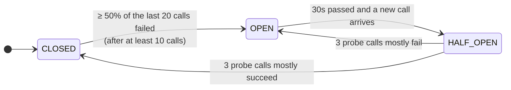
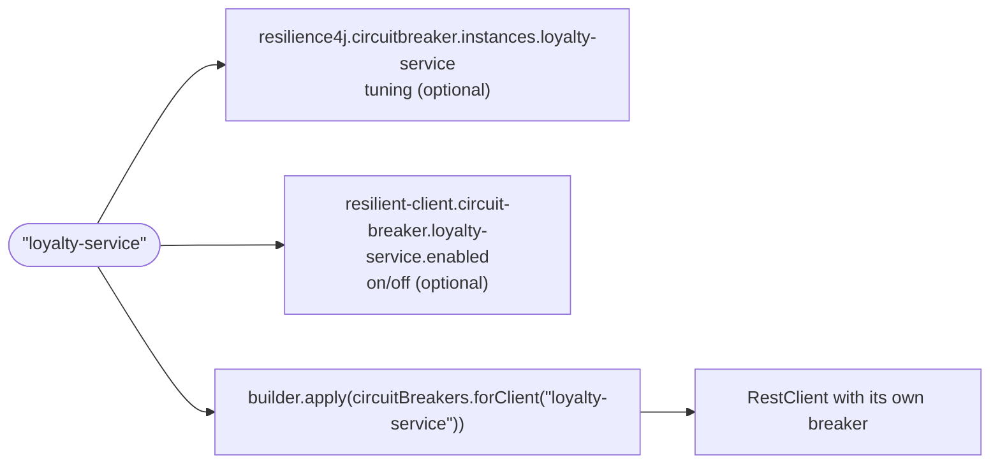

# prototype-integrations: resilient REST clients and error handling

A standalone prototype of two things meant for the cc-auth rewrite:

1. A reusable, low-ceremony **circuit breaker** for every outbound `RestClient`.
2. One **error-handling pattern** that replaces per-call `try/catch` ladders.

The library never builds your client. It hands you one `Consumer<RestClient.Builder>` to add to a builder you already have (an OpenAPI-generated `ApiClient`'s, a hand-written `RestClient` bean's, an HTTP interface proxy's):

```java
RestClient restClient = builder
        .apply(circuitBreakers.forClient("account-service"))   // the only new line
        .build();
```

That line gives the client its own Resilience4j breaker, applied by a `ClientHttpRequestInterceptor`. A second, optional line, `.apply(errorHandling.forClient("account-service"))`, adds:

- one `FailureClassifier` that decides both the breaker outcome and the exception type,
- a single translation and logging point that produces a small sealed exception hierarchy.

Stack: Java 25, Spring Boot 4.1.1 (Framework 7), Apache HttpClient5, Resilience4j 2.4.0 (`resilience4j-spring-boot4`), WireMock (`wiremock-spring-boot`) in tests.

```bash
./gradlew test --console=plain -q   # unit + integration tests, no Docker needed
./gradlew bootRun                    # starts on :8080; the downstreams are placeholder localhost URLs
```

The integration tests are the demo. With `bootRun` and nothing listening on the downstream ports, every call returns the 502 below. That is still enough to watch `/actuator/circuitbreakers`, `/actuator/health` and `/actuator/metrics/downstream.failures`.

## Package layout

| Package (`io.pipecrafts.prototype.integration.*`) | Role |
|---|---|
| `client` | `RestClientCircuitBreakers` and `DownstreamErrorHandling` (the two `forClient(name)` entry points), `ResilientClientAutoConfiguration`, `CircuitBreakerInterceptor`, `DownstreamFailureInterceptor`, `ResilientClientProperties` |
| `failure` | Single source of truth for classification: `FailureClassifier` (+ `DefaultFailureClassifier`), categories and reasons, `ErrorBodyParser`, the sealed exceptions, `CircuitOpenIOException`, status handler, translator, `DownstreamFailureLog` |
| `call` | `Downstream.call(...)`, the facade helper |
| `web` | `ApiExceptionHandler`, `ApiProblems` (ProblemDetail factory), `ApiErrorCode` |
| `demo.*` | Four demo downstreams, each with a client class, a facade, a controller and records. `DemoClientsConfiguration` plays "the existing project's client config": an OpenAPI-generated `ProfileApi` plus three hand-written `RestClient` beans |

Dependencies point one way: `demo` → `call`/`failure`/`web`, and `client` → `failure`. The reusable packages never import `demo`.

### The generated profile client

`profile-service` is called through an OpenAPI-generated client, so the demo covers the most common integration case.

- **Spec:** `src/main/resources/openapi/profile-service.yaml`, written by hand from the `Profile` record and the two profile endpoints.
- **Generator:** the `org.openapi.generator` Gradle plugin (7.25.0), `java` generator with the `restclient` library, configured in `openApiGenerate` in `build.gradle.kts`.
- **Output:** `build/generated/openapi`, packages `demo.profile.generated.{api,model,invoker}`. Nothing generated is checked in; `compileJava` depends on `openApiGenerate`, so any build regenerates it. Run `./gradlew openApiGenerate` to regenerate on its own after editing the spec.
- **Wiring:** `DemoClientsConfiguration.profileApi` starts from the generated `ApiClient.buildRestClientBuilder()` (keeping its Jackson converter and date handling), applies the two `forClient` lines and passes the result to `new ApiClient(restClient)`. `ProfileClient` wraps `ProfileApi` and maps the generated `ProfileDto` to the demo's `Profile`.
- **Jackson 2:** the generated code uses `com.fasterxml.jackson`, so `jackson-databind` and `jackson-datatype-jsr310` are on the classpath for it alone. The no-arg `buildRestClientBuilder()` is used because the `ObjectMapper` overload needs a Jackson 2 mapper, which Boot 4 doesn't provide. Expect two deprecation warnings from the generated code.

## Failure taxonomy

Every downstream outcome lands in exactly one category. Statuses are classified by **one** `FailureClassifier`, which both the breaker and the status handler consult, so they can't disagree. I/O failures are always `DEPENDENCY_FAILURE`.

| Category | Triggers (default) | Breaker records | Surfaces as | API response |
|---|---|---|---|---|
| `SUCCESS` | 2xx | success | normal return | 200 |
| `BUSINESS` | 4xx except 401/403/408/429 (400, 404, 409, 422, ...) | **success**: the dependency is healthy | `DownstreamBusinessException` with the parsed `DownstreamError(code, message)` | facade's own code, else 422 `DOWNSTREAM_REJECTED` |
| `DEPENDENCY_FAILURE` | 5xx, 408, 429, any `IOException` (timeout, refused, reset, DNS), open circuit, undecodable 2xx body, 1xx and unfollowed 3xx | **failure** | `DependencyFailedException` | 502 `DEPENDENCY_FAILED` |
| `DEPENDENCY_REJECTED` | 401, 403 | **ignored** by default (configurable per client) | `DependencyFailedException(reason = UNAUTHORIZED)` | 502 `DEPENDENCY_FAILED` |

Internal reasons, which only ever appear in logs and metrics: `SERVER_ERROR`, `TIMEOUT`, `CONNECTION_FAILED`, `CIRCUIT_OPEN`, `UNAUTHORIZED`, `THROTTLED`, `MALFORMED_RESPONSE`.

**Why 401/403 fold into the 502.** A 401/403 means *our* credentials or configuration are wrong. The customer can't fix that, so it must look exactly like an outage to the caller. It still gets a distinct `UNAUTHORIZED` reason at WARN plus a metric tag, so a bad deploy or rotated secret is alertable and never mistaken for a business outcome.

**Why 401/403 are ignored by the breaker by default.** A credentials fault says nothing about whether the dependency is up. Counting it as a failure would open the breaker on a config error. Counting it as a success would dilute a real outage happening at the same time. So the permission is released and nothing is recorded. A client can opt into "count as failure" (see escape hatch 2).

Exceptions form a sealed hierarchy: `DownstreamException` permits `DependencyFailedException` and `DownstreamBusinessException`. Both carry `dependency`, `operation` and `httpStatus()` (empty for I/O failures). `reason` lives on `DependencyFailedException` only. Exception messages are built from those fields alone and never include bodies, headers or URLs.

## Circuit breaker at a glance

> Full walkthrough with more diagrams, a per-client customization table and a "where to look in the code" map: **[docs/circuit-breaker.md](docs/circuit-breaker.md)**.

Each client gets its own breaker, named after the client. The breaker only counts **dependency failures**; business 4xx count as success and 401/403 aren't counted at all.



While **OPEN**, every call fails fast with 502 `DEPENDENCY_FAILED` (`reason=CIRCUIT_OPEN`) and nothing reaches the network. Thresholds come from `resilience4j.circuitbreaker.configs.default` and can be tuned per client.

**Reusing it is one line.** Any `RestClient.Builder` that gets `.apply(circuitBreakers.forClient("<name>"))` before `.build()` is protected; there is no breaker code in clients or facades:



See [Adding a fifth downstream](#adding-a-fifth-downstream) for the code and the [Escape-hatch cookbook](#escape-hatch-cookbook) for per-client tweaks.

## Call pipeline and ordering

```
Facade ── client.getProfile(id) ── restClient.get().uri("/profiles/{id}", id).retrieve().body(...)
  RestClient (built from the project's own builder)
   ├─ the project's own interceptors (auth, tracing headers)
   │   └─ DownstreamFailureInterceptor   (only with errorHandling.forClient)
   │        IOException -> DependencyFailedException (TIMEOUT / CONNECTION_FAILED / CIRCUIT_OPEN), logged once
   │       └─ CircuitBreakerInterceptor   (circuitBreakers.forClient, applied last = innermost)
   │                OPEN?  -> throw CircuitOpenIOException (never touches the wire)
   │                else   -> execute, buffer the whole body, classify the raw status,
   │                          record success / failure / ignored with duration
   │            └─ HttpClient5 (automatic retries disabled by the project) ── wire ── downstream
   └─ DownstreamStatusHandler   (only with errorHandling.forClient; runs AFTER the chain returns; matches every status)
        same classifier -> no-op | DownstreamBusinessException | DependencyFailedException, logged once
```

Rules:

- **The breaker is innermost, by ordering rule.** Apply `circuitBreakers.forClient(...)` last, after the project's own interceptors, and error handling (if used) before it. Nothing enforces this in code.
- **The breaker never relies on handler exceptions.** It sees raw statuses and raw `IOException`s. The status handler runs later, inside `RestClient`, on the buffered response.
- **Translation and logging happen exactly once**, in the failure interceptor (I/O) or the status handler (statuses). Facades never log downstream failures. RestClient rethrows runtime exceptions from interceptors unchanged, so with error handling applied callers never see a `ResourceAccessException`. With the breaker alone they do: I/O failures and an open circuit arrive as a `ResourceAccessException` (cause `CircuitOpenIOException` for the open circuit), as described in [docs/circuit-breaker.md](docs/circuit-breaker.md#what-callers-see-with-the-breaker-alone).
- **The body is fully buffered inside the breaker.** Measured duration therefore includes body transfer, so slow-call thresholds mean something, and a mid-body timeout is counted by the breaker. Streaming or large-payload clients should set `resilient-client.circuit-breaker.<name>.enabled: false`.
- **Disable HttpClient5's automatic retry** (the demo does it in `DemoClientsConfiguration`; the library does not change a project's HTTP client). Otherwise it silently resends 429/503 after one second regardless of HTTP method, POSTs included. That would hide two attempts inside one breaker measurement.
- **The classifier is the only authority.** Never set `recordExceptions`, `ignoreExceptions` or `recordResult` in `resilience4j.circuitbreaker.*`.
- **Status handler pre-emption.** The handler is registered for every status, so Spring's default 4xx/5xx handler is never reached. A classifier that maps a 4xx to success really does yield a normal decode.

## Adding a fifth downstream

The client name is used everywhere: the Resilience4j instance name, the `resilient-client.circuit-breaker.<name>` key, and the string passed to `forClient`. In this demo it is also the `demo.clients.<name>` key; in a real project transport config stays wherever the project keeps it today.

```diff
 # application.yaml
 demo.clients:
+  loyalty-service:
+    base-url: https://loyalty.internal
+    connect-timeout: 500ms
+    read-timeout: 2s
```

The only library-related change is one `.apply(...)` line where the client is built (here, in `DemoClientsConfiguration`):

```diff
+    @Bean("loyalty-service")
+    RestClient loyaltyRestClient(RestClient.Builder builder, DemoClientsProperties properties,
+            RestClientCircuitBreakers circuitBreakers) {
+        return base(builder, properties.client("loyalty-service"))
+                .apply(circuitBreakers.forClient("loyalty-service"))
+                .build();
+    }
```

Add `.apply(errorHandling.forClient("loyalty-service"))` before it for typed exceptions. Breaker tuning is optional YAML under `resilience4j.circuitbreaker.instances.loyalty-service`; without it, `configs.default` applies.

Use `uri(String template, vars...)`: the template becomes the `operation` name in logs and metrics. A call built only from a `URI` or a `UriBuilder` function is logged as `operation=GET unknown`. The generated client calls `uri(template, pathParams)`, so its operations are bounded too (`GET /profiles/{id}`).

### Why not auto-instrument existing clients?

| | Auto-instrument at startup | By hand in existing config | **Chosen: one-line `Consumer<RestClient.Builder>` + auto-config** |
|---|---|---|---|
| Generated `new ApiClient()` (internal `RestClient`, not a bean) | Can't see it without reflection or rebuilding the `ApiClient` | Works | Works |
| Breaker name | Guessed from bean name; breaks on rename | Explicit | Explicit, same string as the YAML key |
| Per-client policy | Needs a side channel | Free-form | `forClient(name, classifier)` |
| Reader's question "where does the breaker come from?" | Magic | Clear, but 80 copied lines | Clear: the line is in the client's own config |

## Escape-hatch cookbook

Deviation is opt-in and local. You never fork the shared code.

**1. Config only: per-client breaker tuning, or no breaker at all.** Tests: scenarios 16 and 17.

```yaml
resilience4j.circuitbreaker.instances:
  account-service:
    baseConfig: default
    slowCallDurationThreshold: 1s
    slowCallRateThreshold: 50
resilient-client.circuit-breaker:
  account-service:
    enabled: false   # forClient returns a no-op; classification, translation and logging unchanged
```

**2. Per-client policy and builder tweaks: share one classifier.** Tests: scenarios 19, 20 and 22.

```java
FailureClassifier policy = DefaultFailureClassifier.builder()
        .countRejectedAsFailure(true)                 // 401/403 open this client's breaker
        .override(409, Classification.success())      // duplicate submission = already accepted
        .build();
RestClient restClient = base(builder, properties.client(NOTIFICATION))
        .defaultHeader("X-Api-Key", apiKey)
        .apply(errorHandling.forClient(NOTIFICATION, policy))
        .apply(circuitBreakers.forClient(NOTIFICATION, policy))   // breaker last
        .build();
```

The classifier drives the breaker **and** the status handler. Here, a 409 is decoded into a normal `NotificationReceipt` and recorded as a breaker success. To treat a status as an outage instead, use `.override(409, Classification.dependencyFailure(FailureReason.SERVER_ERROR))`.

Pass the **same** classifier instance to both lines so the breaker and the status handler can't disagree. Builder tweaks (headers, extra interceptors) are ordinary builder calls; add them before the two `apply` lines so the breaker stays last. A `defaultStatusHandler` added after `errorHandling.forClient(...)` is never reached, so use a classifier instead. For something that applies to every client, use Boot's `RestClientCustomizer`.

**3. Per-call business mapping with `Downstream.call(...)`.** Tests: scenarios 2–4 and 21. See the next section.

To replace the error-body parser for every client, define an `ErrorBodyParser` bean.

## Business failures without try/catch

The shared status handler already throws the right typed exception, so the common path in a facade is one line:

```java
public Profile findByMobile(String mobile) {
    return client.findByMobile(mobile);          // 404 here -> 422 DOWNSTREAM_REJECTED via the advice
}
```

Where an endpoint has *expected* business outcomes, declare them:

```java
public Optional<Profile> find(String id) {
    return Downstream.call(() -> Optional.of(client.getProfile(id)))
            .onBusiness(404, Optional::empty)
            .get();
}

public VerificationOutcome verify(String challengeId, String code) {
    return Downstream.call(() -> VerificationOutcome.verified(client.verify(challengeId, new VerifyRequest(code))))
            .onBusinessCode("CODE_INCORRECT", CodeIncorrect::new)
            .onBusinessCode("CODE_EXPIRED", CodeExpired::new)
            .get();
}
```

`VerificationOutcome` is sealed (`Verified | CodeIncorrect | CodeExpired`). The controller maps it with an exhaustive `switch`. Every other outcome propagates: unmapped business codes go to 422 `DOWNSTREAM_REJECTED`, and outages, timeouts, 401s and open circuits go to 502.

How the helper behaves:

- It's lazy and immutable.
- Mappings are matched in declaration order and the first match wins.
- Only `DownstreamBusinessException` is ever intercepted. An unmatched one is rethrown as the **same instance**. `DependencyFailedException` is never matched, even by `onBusiness(ex -> true, ...)`.
- It logs nothing, because the shared layer already did.

Both styles appear in the demo:

- **Helper:** `ProfileFacade.find`, `VerificationFacade.verify`.
- **Plain propagation:** `ProfileFacade.findByMobile`, `VerificationFacade.startChallenge`, and the account and notification facades.

### No try/catch check

```bash
grep -rnE '\b(try|catch)\b' src/main/java/io/pipecrafts/prototype/integration/demo   # expect no output
```

## API error contract

`ApiExceptionHandler` (`@RestControllerAdvice`) returns RFC 9457 `ProblemDetail` with an extra `code` property. Bodies are built only from `ApiErrorCode` constants, never from exception messages or downstream content.

| Cause | HTTP | `code` |
|---|---|---|
| `DependencyFailedException` (any reason) | 502 | `DEPENDENCY_FAILED` |
| `DownstreamBusinessException` not handled by a facade | 422 | `DOWNSTREAM_REJECTED` (constant; downstream status/code never forwarded) |
| Facade-translated outcomes | 404 / 422 | `PROFILE_NOT_FOUND`, `VERIFICATION_CODE_INCORRECT`, `VERIFICATION_CODE_EXPIRED` |
| Spring MVC 400s (bean validation, missing/mistyped parameter, unreadable body) | 400 | `INVALID_REQUEST` |
| Anything else | 500 | `INTERNAL_ERROR` |

The 502 body for every reason (5xx, timeout, reset, 401/403, 429, malformed, open circuit) is:

```json
{"detail":"A required service is currently unavailable. Please try again later.","instance":"/demo/accounts/A1/balance","status":502,"title":"Dependency failed","code":"DEPENDENCY_FAILED"}
```

It's byte-identical across reasons for a given endpoint (scenario 12). Spring fills `instance` with the caller's own request path (never the query string), so bodies differ across endpoints only in that field.

## Observability

- **Logs.** One line per failure from `DownstreamFailureLog`: WARN for dependency failures, INFO for business failures. It uses SLF4J key-values, also rendered in the message, for example `dependency=account-service operation=GET /accounts/{id}/balance outcome=DEPENDENCY_FAILURE reason=TIMEOUT httpStatus=none downstreamCode=none cause=SocketTimeoutException`.
  - `operation` is the HTTP method plus the URI *template* (`GET /profiles/{id}`), never the expanded URI or query string, because those carry PII such as mobile numbers.
  - Only the root-cause *type* is logged, because transport messages contain URLs.
  - The downstream `message` and a ≤512-character body snippet are logged at DEBUG only. Headers are never logged.
- **Metric.** `downstream.failures{dependency, operation, category, reason}`. All tags are bounded. Breaker metrics come from `resilience4j-micrometer`, and per-call latency comes from Boot's `http.client.requests`.
- **Actuator.** `/actuator/circuitbreakers`, `/actuator/circuitbreakerevents`, `/actuator/health`. Breakers are created eagerly, so all four show from startup. `allowHealthIndicatorToFail: false`: an open downstream never takes our own health or liveness down.

## Mapping to cc-auth

| cc-auth today | Replaced by |
|---|---|
| `MfaServiceClient`'s catch ladder: catch `HttpCallException`, inspect the status, log, then translate per operation | `VerificationFacade.verify`: one `Downstream.call(...)` declaring the two expected codes. Classification, logging and translation of everything else happen once in the shared layer. 401/403 become a 502 with `reason=UNAUTHORIZED` instead of being mistaken for a business answer. |
| `CustomerLookupService`'s 404 handling (catch, check for 404, return empty) | `ProfileFacade.find`: `.onBusiness(404, Optional::empty)`. The same 404 on an endpoint that doesn't expect it propagates as `DOWNSTREAM_REJECTED`; it isn't silently swallowed. |
| `HttpExchangesConfiguration` (hand-built clients, per-client timeouts, interceptors and error handlers) | Keep the existing client config; add `.apply(circuitBreakers.forClient(name))` (and optionally `errorHandling.forClient(name)`) to each builder, plus `resilience4j.circuitbreaker.instances.<name>` for breaker tuning. Per-client deviation is a classifier shared by the two lines. |

Points to raise during the rewrite:

- cc-auth very likely runs with HttpClient5's default retry on, since Boot doesn't disable it. That means POSTs may be resent after one second on 503/429 today.
- Actuator must sit on the secured management port, because `/actuator/circuitbreakers` reveals dependency topology.
- The `client` package is wired by a real Boot auto-configuration (`META-INF/spring/...AutoConfiguration.imports`), so extracting it with `failure`, `call` and `web` into a starter is a file move.

## Decisions

1. **Client style.** The library doesn't build clients. It exposes `forClient(name)` returning a `Consumer<RestClient.Builder>`, applied with the plain Spring `RestClient.Builder.apply(...)`, so it fits generated `ApiClient`s, hand-written `RestClient`s and HTTP interface proxies alike.
   - Auto-instrumenting existing clients was rejected: a generated `new ApiClient()` builds a private `RestClient` that is neither a bean nor built from Boot's builder, so only reflection or rebuilding the `ApiClient` could reach it, and breaker names would have to be guessed.
   - Per-client policy is a classifier passed to `forClient(name, classifier)`, next to the client it affects.
   - Error translation is a separate optional line because it changes the exception types callers see.
   - The OpenAPI-generated client targets Jackson 2 (`com.fasterxml.jackson`) while Boot 4 uses Jackson 3; both sit on the classpath, Jackson 2 only for the generated code.
2. **`Downstream.call` shape.** A small immutable fluent object (`onBusiness`, `onBusinessCode`, general predicate form, then `get()`), not static functions. It reads as a declaration of expected outcomes, there's one terminal call, and there's no overload explosion. Map success inside the supplier.
3. **401/403 and the breaker.** Ignored (permission released, nothing recorded) by default. A client opts into counting them as failures with `DefaultFailureClassifier.builder().countRejectedAsFailure(true)`. There's deliberately no global property, so per-client policy has exactly one mechanism.
4. **`reason` as a metric.** Yes: `downstream.failures` carries `reason` (`none` for business failures).

Also decided:

- Unmapped business errors are a constant 422 `DOWNSTREAM_REJECTED`. A downstream 404/400 never masquerades as ours.
- The 502 is identical per endpoint (`instance` differs across endpoints).
- A 2xx with an undecodable body returns 502 `MALFORMED_RESPONSE` but is recorded as a breaker **success**. Decoding happens after the interceptors and status handler, so `ApiExceptionHandler` maps the leftover `RestClientException` and logs it; that log line has no `dependency`. A contract bug isn't an availability problem.
- No automatic retry anywhere.

## Known limitations

- A read timeout on a POST is ambiguous: the downstream may have acted. We return 502. Idempotency keys are out of scope.
- A half-open probe can be a POST.
- HttpClient5's connection-pool lease timeout (default 3 min) isn't exposed by Boot properties. Under pool exhaustion it can outlast every configured timeout.
- Whole-body buffering suits small JSON APIs only.

## Test scenario index

All in `src/test/java/io/pipecrafts/prototype/integration/`. Test `@DisplayName`s carry these numbers.

| # | Scenario | Test |
|---|---|---|
| 1 | All 8 endpoints return 200 with the payload mapped | `ResilientRestClientIntegrationTest.HappyPath` (4 tests, 2 endpoints each) |
| 2 | profile 404 → 404 `PROFILE_NOT_FOUND` | `BusinessFailures.profileNotFound` |
| 3 | verification 422 `CODE_INCORRECT` → facade outcome | `BusinessFailures.wrongCode` |
| 4 | 422 `CODE_EXPIRED` → different outcome | `BusinessFailures.expiredCode` |
| 5 | Unmapped 4xx → `DOWNSTREAM_REJECTED` | `BusinessFailures.unmappedBusinessError`, `unmappedCodeThroughHelper` |
| 6 | More business failures than the window never open the breaker | `BusinessFailures.manyBusinessFailures` |
| 7 | Non-JSON / empty error bodies | `BusinessFailures.tolerantErrorBodies` |
| 8 | 500 / 503 / 504 → 502 | `DependencyFailures.serverErrors` |
| 9 | Connection reset, read timeout → 502 | `DependencyFailures.connectionReset`, `readTimeout` |
| 10 | 401 / 403 → same 502, `reason=UNAUTHORIZED` in logs | `DependencyFailures.rejectedCredentials` |
| 11 | 429 → `THROTTLED`, sent exactly once; no hidden retry on POST | `DependencyFailures.throttled`, `noHiddenRetryOnPost` |
| 12 | Byte-identical 502 bodies across all reasons | `DependencyFailures.identicalBodies` |
| 13 | N × 5xx open the breaker; the next call never reaches WireMock | `CircuitBreakerBehaviour.opensAndFailsFast` |
| 14 | Half-open probe closes / reopens | `CircuitBreakerBehaviour.halfOpenProbeSucceeds`, `halfOpenProbeFails` |
| 15 | Isolation between breakers | `CircuitBreakerBehaviour.isolation` |
| 16 | Slow 200s open the breaker | `CircuitBreakerBehaviour.slowCallsOpenBreaker` |
| 17 | `breaker.enabled=false` never opens | `BreakerDisabledByPropertyIntegrationTest` (own context) |
| 18 | Actuator exposes breaker state | `CircuitBreakerBehaviour.actuatorShowsState` |
| 19 | Classifier override (409 → success) | `EscapeHatches.classifierOverride` |
| 20 | Customizer header sent, only to its client | `EscapeHatches.customizerHeader` |
| 21 | Per-call 404 mapping vs unmapped elsewhere | `EscapeHatches.perCallBusinessMapping` |
| 22 | 401-as-failure override opens one breaker, not the default client's | `EscapeHatches.rejectedCountsAsFailureOnlyWhenConfigured` |

The integration tests share one application context. Breaker state is shared within it, so don't enable JUnit parallel execution.

Unit tests:

- `DefaultFailureClassifierTest`: decision table.
- `TolerantErrorBodyParserTest`: never throws.
- `CircuitBreakerInterceptorTest`: outcome recording, slow calls on a fake clock, and the permission invariant.
- `DownstreamFailureTranslatorTest`: I/O cause → reason.
- `DownstreamCallTest`: helper semantics.
- `ApiExceptionHandlerTest`: identical 502 for every reason, `INVALID_REQUEST`.

> The scenario index and test list above describe the tests as written against the previous construction API; they still need retargeting at the new wiring (and `ResilientClientStartupValidationTest` is obsolete).

## Future

Explicitly out of scope here:

- **Retry.** Resilience4j `Retry`, or Spring Framework 7's `@Retryable`, only for idempotent operations, outside the breaker, with idempotency keys for POSTs.
- **Concurrency limits.** Resilience4j `Bulkhead` or Framework 7's `@ConcurrencyLimit` per downstream.
- **Rate limiting.** Resilience4j `RateLimiter` for downstreams with published quotas.
- **Packaging.** Extract `client`/`failure`/`call`/`web` into a Boot starter for cc-auth (the auto-configuration already exists).
- **Breaker accounting.** Record `MALFORMED_RESPONSE` on the breaker, if the team decides contract breaks should count as unavailability.
