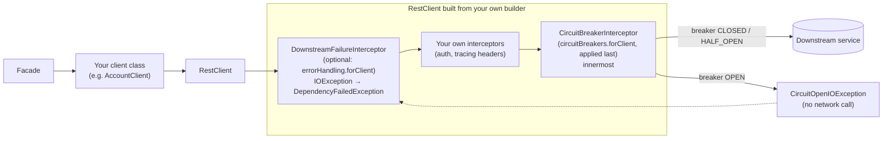
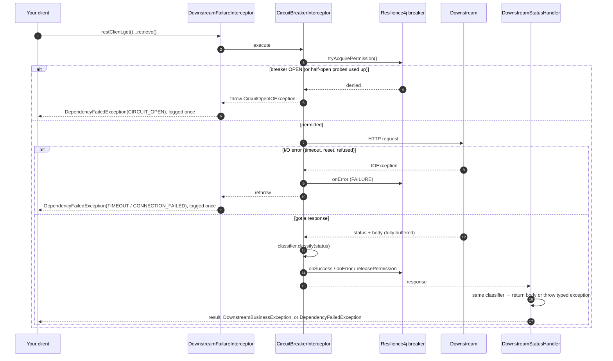
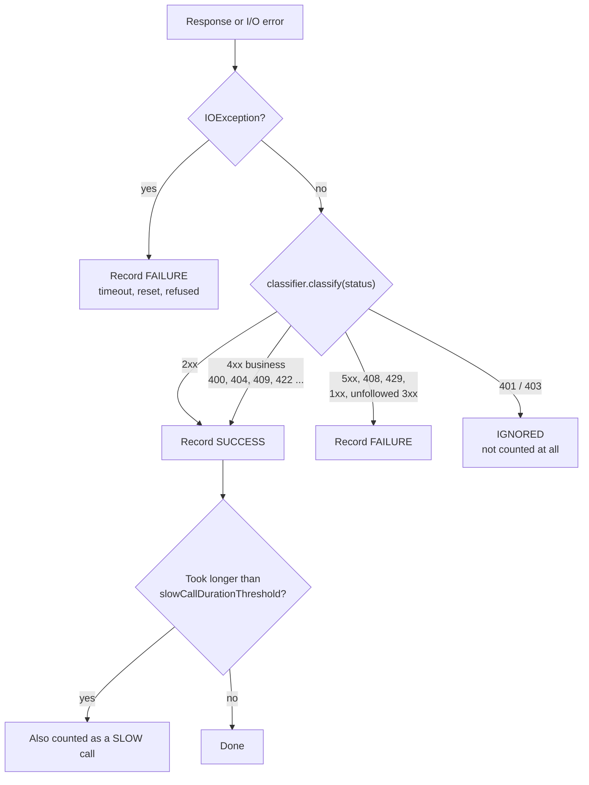
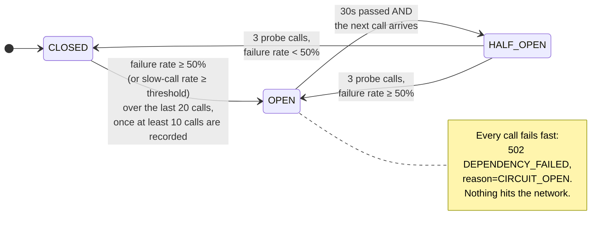
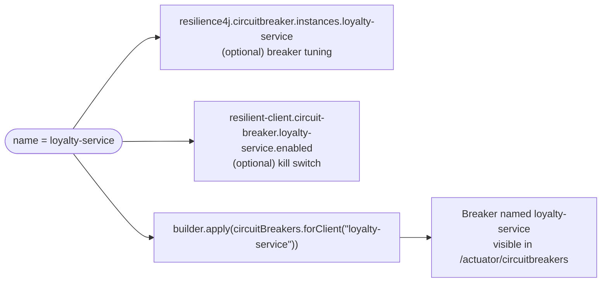

# Circuit breaker guide

How the circuit breaker in this project works, and how to add it to a `RestClient` you already have. The README has the full reference; this page is the "how do I think about it" version.

## The short version

- Every `RestClient` whose builder gets `.apply(circuitBreakers.forClient(name))` has its **own** Resilience4j circuit breaker, named after the client.
- The breaker counts **dependency failures** (5xx, timeouts, refused connections, 408, 429). It does **not** count business errors (404, 409, 422, ...), because those mean the downstream is up and answering.
- When too many recent calls failed, the breaker **opens**: calls fail fast and never reach the network (a 502 when error translation is also applied). After a cool-down it lets a few probe calls through to check whether the downstream has recovered.
- The library never builds your client. It adds one interceptor to the `RestClient.Builder` you already have, so it works the same for OpenAPI-generated clients, hand-written `RestClient` beans and HTTP interface proxies.
- Error translation (`DownstreamBusinessException` / `DependencyFailedException` and the single 502) is a separate, optional second line.

## Where the breaker sits



The breaker is the **innermost** interceptor on purpose: it sees the raw HTTP status and raw `IOException`s before anything translates them, so its bookkeeping can't be confused by other interceptors or by exception mapping.

An open circuit is thrown as an `IOException` (`CircuitOpenIOException`), so it travels the same path as "connection refused". With error translation it comes out as `DependencyFailedException(reason = CIRCUIT_OPEN)` → HTTP 502 `DEPENDENCY_FAILED`; with the breaker alone, `RestClient` wraps it in the `ResourceAccessException` the project already handles.

### What callers see with the breaker alone

| Situation | Exception (unchanged Spring behaviour, except the open circuit) |
|---|---|
| 2xx | normal return |
| 4xx / 5xx | whatever the client already did, e.g. `HttpClientErrorException` / `HttpServerErrorException` from `retrieve()` |
| timeout / refused | `ResourceAccessException` (cause: the `IOException`) |
| **circuit open** | `ResourceAccessException` with cause `CircuitOpenIOException`, and no network call |

Code that needs to tell the cases apart checks `e.getCause() instanceof CircuitOpenIOException`.

### Ordering rule

Apply the breaker **last**, after the project's own interceptors (auth, tracing headers). It then sits innermost and sees raw statuses and raw `IOException`s. Interceptors added after it run inside the breaker's measurement: harmless for header-only interceptors, but avoid anything that retries or makes calls of its own. When both lines are used, apply error handling first and the breaker last, so the failure interceptor sits outside the breaker and can translate an open circuit. Nothing enforces this in code.

## What happens on one call



The key point: the breaker and the status handler both ask the **same** `FailureClassifier`. They can never disagree about whether a status was an outage.

## How a response is counted



Why business 4xx count as **success**: a 404 means the downstream is healthy and answered correctly. Counting it as a failure would let ordinary "not found" traffic open the breaker.

Why 401/403 are **ignored**: they mean *our* credentials or config are wrong, which says nothing about whether the downstream is up. A client can opt in to counting them as failures (see [Customizing](#customizing-per-client)).

## The breaker's states



Numbers above are the `configs.default` values in `application.yaml`:

| Setting | Default | Meaning |
|---|---|---|
| `slidingWindowSize` | 20 | Look at the last 20 recorded calls |
| `minimumNumberOfCalls` | 10 | Don't judge until at least 10 calls are in the window |
| `failureRateThreshold` | 50 | Open when ≥ 50% of the window failed |
| `waitDurationInOpenState` | 30s | Stay open at least this long |
| `permittedNumberOfCallsInHalfOpenState` | 3 | Probe with 3 calls before deciding |
| `automaticTransitionFromOpenToHalfOpenEnabled` | false | Move to half-open lazily, on the first call after 30s |

Example with defaults: 10 calls to `profile-service`, 5 return 503 → 50% failure → breaker opens. For the next 30 seconds, every call to `profile-service` returns 502 immediately. Other clients (`account-service`, etc.) are unaffected; each has its own breaker.

## Using it on an existing client

Step 0 for every project: add the dependency, and `resilience4j.circuitbreaker.instances.<name>` YAML if the client needs its own thresholds (otherwise `configs.default` applies). The name is the key that ties everything together: the breaker, the YAML and the optional kill switch.



The integration point is one line on a `RestClient.Builder` you already have:

```java
RestClient restClient = builder
        .apply(circuitBreakers.forClient("account-service"))   // the only new line
        .build();
```

**1. Generated `ApiClient`, project currently uses `new ApiClient()`.** Switch to the `RestClient` constructor and keep the generated defaults by starting from the generated builder (this is `DemoClientsConfiguration.profileApi`):

```java
@Bean
ProfileApi profileApi(RestClientCircuitBreakers circuitBreakers, DownstreamErrorHandling errorHandling) {
    RestClient restClient = ApiClient.buildRestClientBuilder()   // generated: Jackson converter + date format
            .requestFactory(requestFactory)
            .apply(errorHandling.forClient("profile-service"))   // optional
            .apply(circuitBreakers.forClient("profile-service")) // last
            .build();
    ApiClient apiClient = new ApiClient(restClient);
    apiClient.setBasePath("https://profile.internal");
    return new ProfileApi(apiClient);
}
```

Never call `apiClient.setDebugging(true)`: it logs request and response bodies.

**2. Generated `ApiClient`, project already passes a `RestClient`.** Add one `.apply(...)` to the builder that is already there.

**3. Subclassed `ApiClient` overriding `buildRestClientBuilder`.** Same line, inside the override (the subclass needs the bean passed in).

**4. Hand-written `RestClient` bean or HTTP interface proxy.** Same line on the builder before `.build()`. For `HttpServiceProxyFactory`, apply it to the `RestClient` you hand to `RestClientAdapter.create(...)`.

**5. Spring HTTP Service Registry (`@ImportHttpServices`).** Inside a `RestClientHttpServiceGroupConfigurer`:

```java
groups.filterByName(name).forEachClient((group, builder) -> builder.apply(circuitBreakers.forClient(name)));
```

**Optional: error translation.** `errorHandling.forClient(name)` installs the status handler and failure interceptor, so callers get `DownstreamBusinessException` / `DependencyFailedException` and `ApiExceptionHandler` folds dependency failures into the single 502. This changes the exception types callers see, so it is opt-in per client. To keep "breaker and handler can never disagree", pass the **same** classifier instance to both:

```java
FailureClassifier policy = DefaultFailureClassifier.builder().override(409, Classification.success()).build();
builder.apply(errorHandling.forClient(NOTIFICATION, policy))
       .apply(circuitBreakers.forClient(NOTIFICATION, policy));   // breaker last
```

**Retries.** HttpClient5's automatic retries hide several attempts inside one breaker measurement; disable them on the request factory (`HttpClientBuilder::disableAutomaticRetries`), as `DemoClientsConfiguration` does. Likewise, if a project retries around generated `*Api` calls (Spring Retry, `@Retryable`), every retry counts as a separate breaker call.

## Customizing per client

All options are local to one client. You never edit the shared code.

| I want to... | Do this |
|---|---|
| Tune thresholds for one client | `resilience4j.circuitbreaker.instances.<name>` with `baseConfig: default` and the overrides (see `account-service` and `notification-service` in `application.yaml`) |
| Open the breaker on slow responses | `slowCallDurationThreshold: 1s` and `slowCallRateThreshold: 50` on the instance |
| Turn the breaker off for one client | `resilient-client.circuit-breaker.<name>.enabled: false` (`forClient` then returns a no-op; error handling and logging still apply) |
| Count 401/403 as failures | `forClient(name, DefaultFailureClassifier.builder().countRejectedAsFailure(true).build())` |
| Treat a specific status differently | `DefaultFailureClassifier.builder().override(409, Classification.success())` (or `Classification.dependencyFailure(...)` to make it count as an outage) |

Example combining a shared classifier and a header (from `DemoClientsConfiguration.notificationRestClient`):

```java
FailureClassifier policy = DefaultFailureClassifier.builder()
        .countRejectedAsFailure(true)
        .override(409, Classification.success())
        .build();
return base(builder, properties.client(NOTIFICATION))
        .defaultHeader("X-Api-Key", apiKey)
        .apply(errorHandling.forClient(NOTIFICATION, policy))
        .apply(circuitBreakers.forClient(NOTIFICATION, policy))
        .build();
```

Rules to keep in mind:

- **Never** set `recordExceptions`, `ignoreExceptions` or `recordResult` in the Resilience4j config. The classifier decides outcomes; those settings would fight it.
- Disable the breaker for streaming or large-payload clients: it buffers the whole body so it can time the full call.
- There's no retry. A retry would go *outside* the breaker, and only for idempotent calls.

## Watching it

| Where | What you see |
|---|---|
| `GET /actuator/circuitbreakers` | Current state and failure rate per client |
| `GET /actuator/circuitbreakerevents` | Recent successes, errors, ignored calls and state transitions |
| `GET /actuator/health` | Breaker state per client (an open breaker does **not** make our health DOWN) |
| Logs | `reason=CIRCUIT_OPEN` when calls are short-circuited |
| Metrics | `resilience4j.circuitbreaker.*` and `downstream.failures{reason="CIRCUIT_OPEN"}` |

## Where to look in the code

| File | What it does |
|---|---|
| `client/RestClientCircuitBreakers.java` | `forClient(name[, classifier])`: the one line a project adds to its builder |
| `client/DownstreamErrorHandling.java` | Optional second line: status handler and failure interceptor |
| `client/ResilientClientAutoConfiguration.java` | Registers both beans when Resilience4j is present |
| `demo/DemoClientsConfiguration.java` | Shows the line on a generated client and on hand-written ones |
| `client/CircuitBreakerInterceptor.java` | Acquires permission, calls the downstream, records the outcome |
| `failure/DefaultFailureClassifier.java` | Status → outcome table shared by the breaker and the status handler |
| `failure/CircuitOpenIOException.java` | What an open breaker throws |
| `client/ResilientClientProperties.java` | The `resilient-client.circuit-breaker.<name>.enabled` switch |

Tests that show each behaviour: `CircuitBreakerBehaviour` (open, half-open, isolation, slow calls, actuator), `BreakerDisabledByPropertyIntegrationTest`, `EscapeHatches`, and the unit test `CircuitBreakerInterceptorTest`. (These were written against the previous construction API and still need retargeting at the new wiring.)
