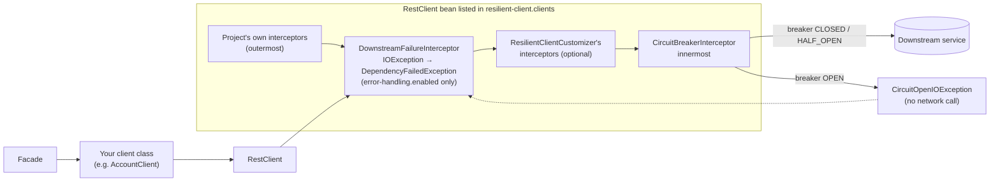
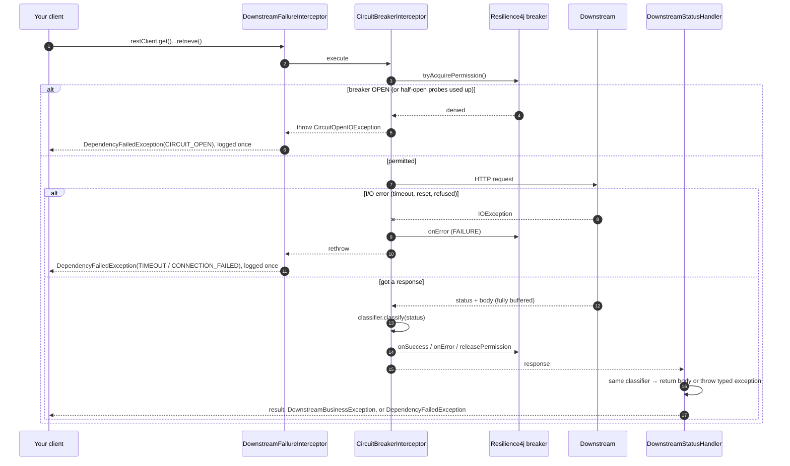
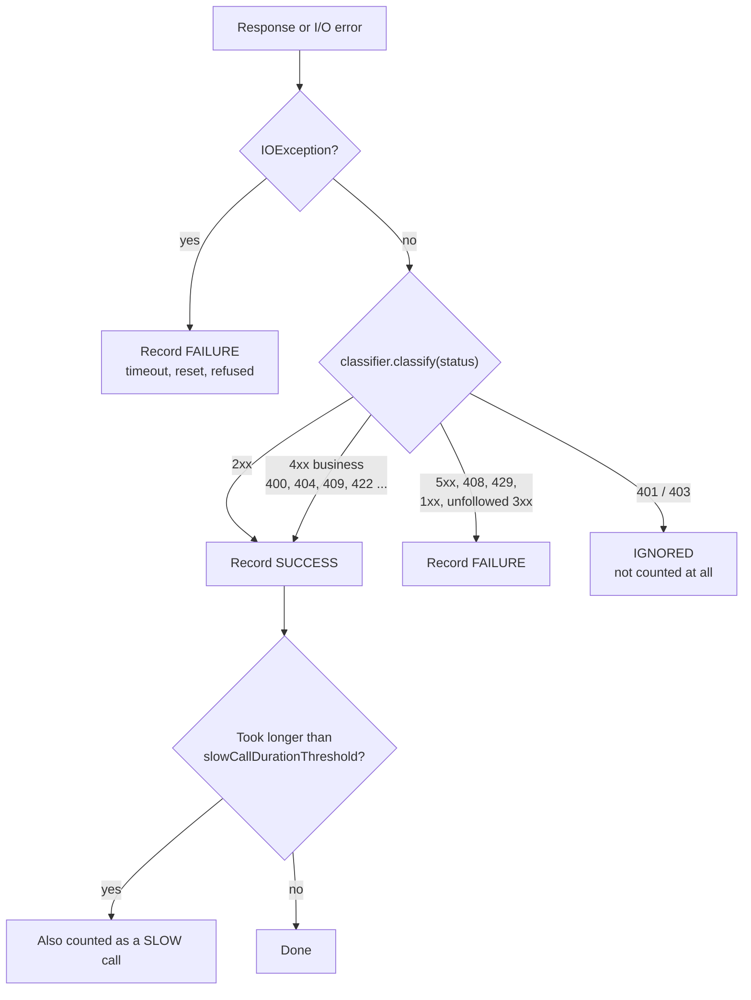
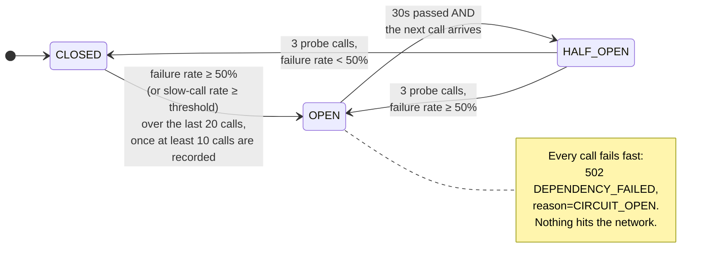
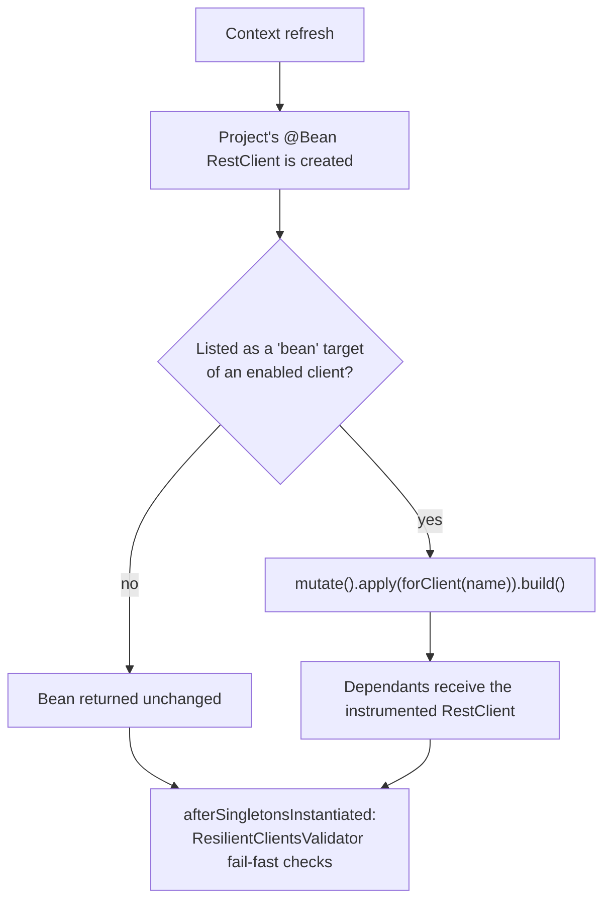

# Circuit breaker guide

How the circuit breaker in this project works, and how to put it on a new client. The README has the full reference; this page is the "how do I think about it" version.

## The short version

- Every `RestClient` bean listed under `resilient-client.clients` in YAML gets its **own** Resilience4j circuit breaker, named after the client. Unlisted beans are untouched.
- The breaker counts **dependency failures** (5xx, timeouts, refused connections, 408, 429). It does **not** count business errors (404, 409, 422, ...), because those mean the downstream is up and answering.
- When too many recent calls failed, the breaker **opens**: calls fail fast with a 502 and never reach the network. After a cool-down it lets a few probe calls through to check whether the downstream has recovered.
- You don't write any breaker code in a client. The project keeps its own `@Bean RestClient`; you add one YAML entry.
- Error handling (typed exceptions, structured logging) is a separate switch per client and is **off** by default, because it changes the exceptions callers see.

## Where the breaker sits



The breaker is the **innermost** interceptor on purpose: it sees the raw HTTP status and raw `IOException`s before anything translates them, so its bookkeeping can't be confused by other interceptors or by exception mapping.

An open circuit is thrown as an `IOException` (`CircuitOpenIOException`), so it travels the same path as "connection refused". With error handling on it comes out as `DependencyFailedException(reason = CIRCUIT_OPEN)` → HTTP 502 `DEPENDENCY_FAILED`; with it off, callers see Spring's `ResourceAccessException` whose cause is the `CircuitOpenIOException`.

## What happens on one call



The key point: the breaker and the status handler both ask the **same** `FailureClassifier`. They can never disagree about whether a status was an outage.

## How a response is counted



Why business 4xx count as **success**: a 404 means the downstream is healthy and answered correctly. Counting it as a failure would let ordinary "not found" traffic open the breaker.

Why 401/403 are **ignored**: they mean *our* credentials or config are wrong, which says nothing about whether the downstream is up. A client can opt in to counting them as failures (see [Escape hatches](#escape-hatches)).

## The breaker's states



Numbers above are the `configs.default` values in `application.yaml`:

| Setting | Default | Meaning |
|---|---|---|
| `slidingWindowSize` | 20 | Look at the last 20 recorded calls |
| `minimumNumberOfCalls` | 10 | Don't judge until at least 10 calls are in the window |
| `failureRateThreshold` | 50 | Open when ≥ 50% of the window failed |
| `waitDurationInOpenState` | 30s | Stay open at least this long |
| `permittedNumberOfCallsInHalfOpenState` | 3 | Probe with 3 calls before deciding |
| `automaticTransitionFromOpenToHalfOpenEnabled` | false | Move to half-open lazily, on the first call after 30s |

Example with defaults: 10 calls to `profile-service`, 5 return 503 → 50% failure → breaker opens. For the next 30 seconds, every call to `profile-service` returns 502 immediately. Other clients (`account-service`, etc.) are unaffected; each has its own breaker.

## Adopting it in a project

1. **Add the dependency.** Nothing happens yet.
2. **Make sure each downstream's `RestClient` is a bean.** Most already are. For an OpenAPI-generated `new ApiClient()`, expose the `RestClient` it builds internally:

   ```java
   @Bean
   RestClient profileRestClient() {
       return ApiClient.buildRestClientBuilder().build();      // generated defaults, now a bean
   }

   @Bean
   ProfileApi profileApi(RestClient profileRestClient, @Value("${clients.profile.base-url}") String baseUrl) {
       ApiClient apiClient = new ApiClient(profileRestClient);  // gets the instrumented instance
       apiClient.setBasePath(baseUrl);
       return new ProfileApi(apiClient);
   }
   ```

3. **List it in YAML.** The breaker is on from then on, and callers keep the exceptions they already handle.
4. **When ready, set `error-handling.enabled: true`** per client and migrate that client's callers to `DownstreamBusinessException` / `Downstream.call`.

```yaml
resilient-client:
  clients:
    profile-service:              # client name = breaker name = log/metric "dependency"
      bean: profileRestClient     # the existing RestClient bean (defaults to the client name)
    notification-service:
      bean: notificationRestClient
      error-handling:
        enabled: true
      policy:
        count-rejected-as-failure: true
        status-overrides:
          409: success
```

At startup the library finds each listed bean and rebuilds it (`restClient.mutate()...build()`) with the breaker, and with error handling when switched on. Dependants receive the instrumented instance.



### YAML reference

```yaml
resilient-client:
  enabled: true                       # global kill switch; false = library does nothing at all
  clients:
    <name>:                           # required key; breaker name and `dependency` in logs/metrics
      enabled: true                   # false = keep the entry but skip it
      bean: <beanName>                # a RestClient bean. Default: <name>
      http-service-group: <group>     # alternative target: a Spring HTTP service group. Exclusive with `bean`
      circuit-breaker:
        enabled: true                 # default true
      error-handling:
        enabled: false                # default false; true installs the status handler + I/O translation
      policy:                         # optional failure taxonomy for this client (breaker AND error handling)
        count-rejected-as-failure: false
        status-overrides:             # status -> success | business | dependency-failure | dependency-rejected
          409: success
```

Breaker tuning stays in the standard `resilience4j.circuitbreaker.instances.<name>` / `configs.default`; the library never copies those settings.

### What callers see

| | `error-handling: false` (default) | `error-handling: true` |
|---|---|---|
| 4xx / 5xx | Spring's `HttpClientErrorException` / `HttpServerErrorException` (unchanged) | `DownstreamBusinessException` / `DependencyFailedException` |
| timeout / refused | `ResourceAccessException` (unchanged) | `DependencyFailedException(TIMEOUT / CONNECTION_FAILED)` |
| circuit open | `ResourceAccessException`, cause `CircuitOpenIOException` | `DependencyFailedException(CIRCUIT_OPEN)` → 502 |

### Interceptor order

Everything is appended after what the bean already configured:

1. the project's own interceptors (outermost),
2. error handling, if enabled (`DownstreamStatusHandler` + `DownstreamFailureInterceptor`),
3. every `ResilientClientCustomizer`, ordered by `@Order`,
4. `CircuitBreakerInterceptor`, always last, so it sees raw statuses and raw `IOException`s.

The same classifier instance goes to the breaker and the status handler, so they cannot disagree.

## Escape hatches

From lightest to heaviest:

| # | I want to... | Do this | Code? |
|---|---|---|---|
| 1 | Tune thresholds, slow calls, wait duration | `resilience4j.circuitbreaker.instances.<name>` | no |
| 2 | Switch one client's breaker or error handling on or off | `clients.<name>.circuit-breaker.enabled` / `error-handling.enabled` | no |
| 3 | Treat a status differently (409 is fine, 401 opens the breaker) | `clients.<name>.policy.*` | no |
| 4 | Add or alter something during instrumentation (header, interceptor, converter) | `ResilientClientCustomizer` bean | small |
| 5 | A policy YAML can't express | `@Bean @Qualifier("<name>") FailureClassifier` (pure: no HTTP client dependencies) | small |
| 6 | Protect a `RestClient` that isn't a bean | `builder.apply(resilientClients.forClient("<name>"))`; it still reads that client's YAML | one line |
| 7 | Change how bodies are parsed or failures logged, for every client | Define your own `ErrorBodyParser` / `DownstreamFailureLog` bean | yes |
| 8 | Replace the mechanism entirely | Define your own `ResilientClients` bean (every library bean is `@ConditionalOnMissingBean`), or exclude `ResilientClientAutoConfiguration` | yes |
| 9 | Temporarily take one client out | `clients.<name>.enabled: false` | no |
| 10 | Turn everything off (incident) | `resilient-client.enabled: false` (also skips validation) | no |

Hatch 4, from the demo (`NotificationApiKeyCustomizer`):

```java
@Bean
ResilientClientCustomizer notificationApiKey(@Value("${demo.notification.api-key}") String apiKey) {
    return (name, builder) -> {
        if (name.equals("notification-service")) {
            builder.defaultHeader("X-Api-Key", apiKey);
        }
    };
}
```

Customizers run inside the error handling and outside the breaker: an interceptor added there is measured by the breaker but its exceptions are not translated. The breaker cannot be reordered; that would be hatch 8.

Hatch 5 resolution order per client: qualified bean, then YAML `policy`, then the default taxonomy. Defining both a qualified bean and a YAML policy for the same client fails startup.

Rules to keep in mind:

- **Never** set `recordExceptions`, `ignoreExceptions` or `recordResult` in the Resilience4j config. The classifier decides outcomes; those settings would fight it.
- Disable the breaker for streaming or large-payload clients: it buffers the whole body so it can time the full call.
- There's no retry. A retry would go *outside* the breaker, and only for idempotent calls.
- One `RestClient` bean per downstream: two client names pointing at one bean fail startup.

## Fail-fast messages

Startup fails with an `IllegalStateException` naming the client and the fix:

| Check | Message |
|---|---|
| Listed `bean` doesn't exist | `resilient-client.clients.profile-service.bean 'profileRestClent' not found. RestClient beans: [profileRestClient, accountRestClient]` |
| Listed bean isn't a `RestClient` | `resilient-client.clients.x: bean 'profileApi' is a ProfileApi, not a RestClient. Point 'bean' at the RestClient it's built from.` |
| Both `bean` and `http-service-group` set | `resilient-client.clients.x: set either bean or http-service-group, not both` |
| Two clients target the same bean | `resilient-client.clients.b: 'a' and 'b' both target bean 'shared'. One RestClient bean per downstream.` |
| Breaker applied twice (YAML and `forClient` in code) | `resilient-client.clients.x: breaker configured twice (YAML and code). Remove one.` |
| Qualified `FailureClassifier` bean and YAML `policy` | `resilient-client.clients.x: policy defined twice. Use the bean or YAML, not both.` |
| `status-overrides` key outside 100-599 | binding error |

## Watching it

| Where | What you see |
|---|---|
| `GET /actuator/circuitbreakers` | Current state and failure rate per client |
| `GET /actuator/circuitbreakerevents` | Recent successes, errors, ignored calls and state transitions |
| `GET /actuator/health` | Breaker state per client (an open breaker does **not** make our health DOWN) |
| Logs | `reason=CIRCUIT_OPEN` when calls are short-circuited |
| Metrics | `resilience4j.circuitbreaker.*` and `downstream.failures{reason="CIRCUIT_OPEN"}` |

## Where to look in the code

| File | What it does |
|---|---|
| `client/ResilientClientProperties.java` | The `resilient-client.*` YAML model |
| `client/ResilientClientInstrumenter.java` | `BeanPostProcessor` that rebuilds listed `RestClient` beans |
| `client/ResilientClients.java` | `forClient(name)`: applies error handling, customizers and the breaker (always last) |
| `client/ClientPolicyResolver.java` | Qualified classifier bean, else YAML policy, else default |
| `client/ResilientClientsValidator.java` | Fail-fast startup checks |
| `client/ResilientClientGroupConfigurer.java` | Same instrumentation for `http-service-group` targets |
| `client/ResilientClientAutoConfiguration.java` | Registers the above (every bean replaceable) |
| `client/CircuitBreakerInterceptor.java` | Acquires permission, calls the downstream, records the outcome |
| `failure/DefaultFailureClassifier.java` | Status → outcome table shared by the breaker and the status handler |
| `failure/CircuitOpenIOException.java` | What an open breaker throws |
| `demo/DemoClientsConfiguration.java` | Plays "the existing project": plain `@Bean RestClient`s, no library imports |

Tests that show each behaviour: `CircuitBreakerBehaviour` (open, half-open, isolation, slow calls, actuator), `BreakerDisabledByPropertyIntegrationTest`, `EscapeHatches`, and the unit test `CircuitBreakerInterceptorTest`.
