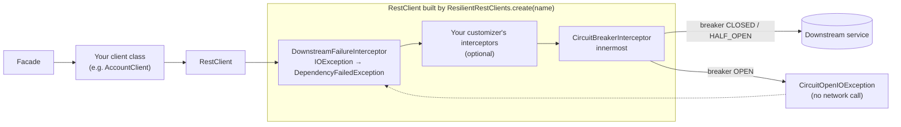
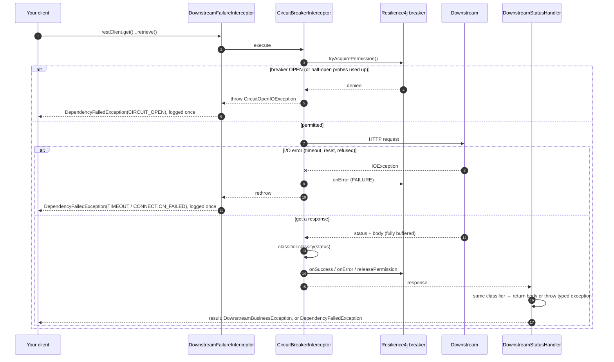
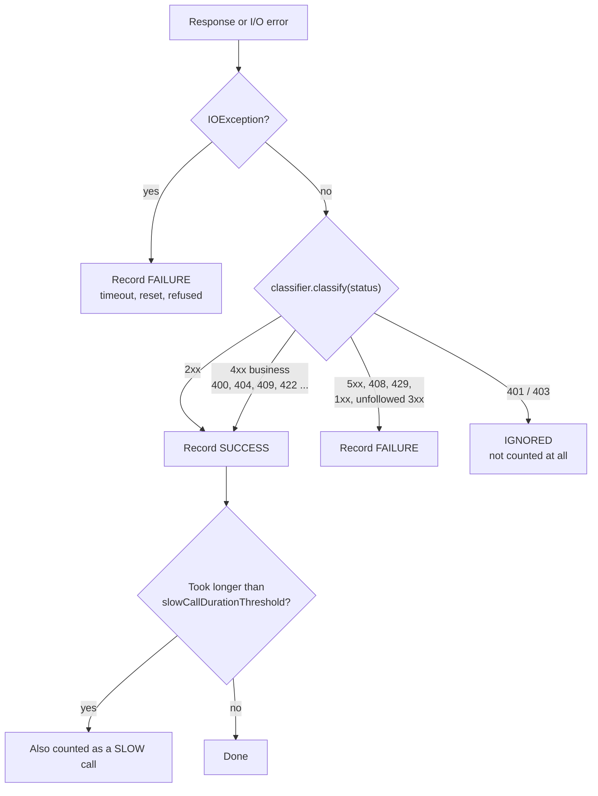
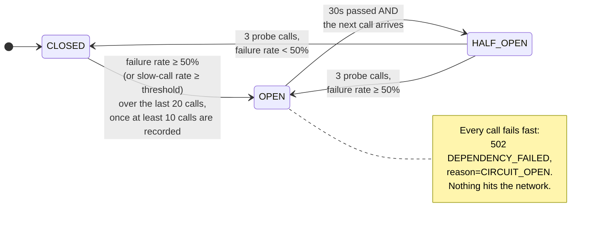
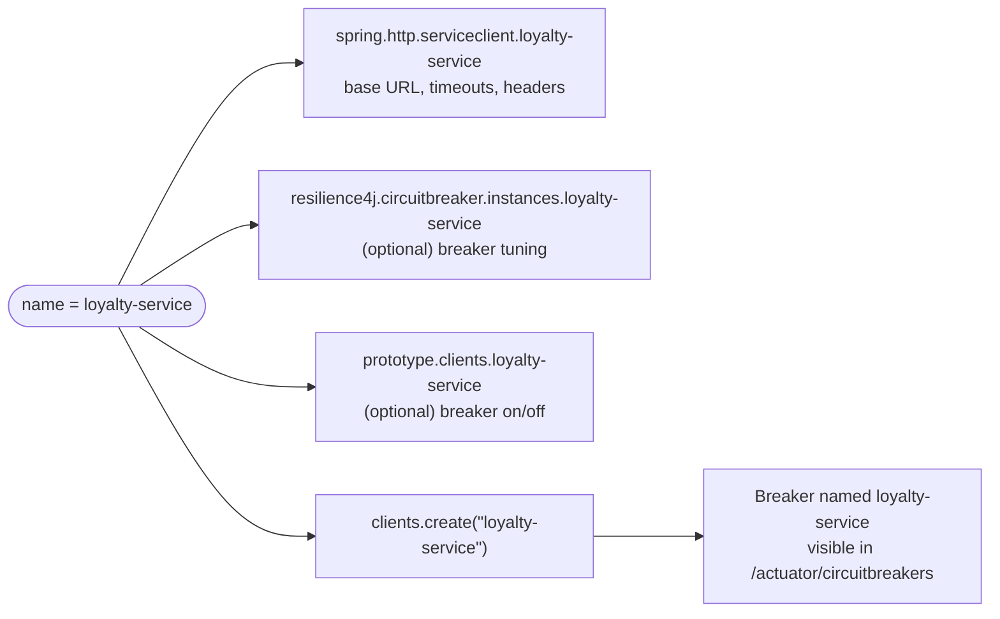

# Circuit breaker guide

How the circuit breaker in this project works, and how to put it on a new client. The README has the full reference; this page is the "how do I think about it" version.

## The short version

- Every `RestClient` built with `ResilientRestClients.create(name)` gets its **own** Resilience4j circuit breaker, named after the client.
- The breaker counts **dependency failures** (5xx, timeouts, refused connections, 408, 429). It does **not** count business errors (404, 409, 422, ...), because those mean the downstream is up and answering.
- When too many recent calls failed, the breaker **opens**: calls fail fast with a 502 and never reach the network. After a cool-down it lets a few probe calls through to check whether the downstream has recovered.
- You don't write any breaker code in a client. You pick a name, add YAML, and call `create(name)`.

## Where the breaker sits



The breaker is the **innermost** interceptor on purpose: it sees the raw HTTP status and raw `IOException`s before anything translates them, so its bookkeeping can't be confused by other interceptors or by exception mapping.

An open circuit is thrown as an `IOException` (`CircuitOpenIOException`), so it travels the same path as "connection refused" and comes out as `DependencyFailedException(reason = CIRCUIT_OPEN)` → HTTP 502 `DEPENDENCY_FAILED`.

## What happens on one call



The key point: the breaker and the status handler both ask the **same** `FailureClassifier`. They can never disagree about whether a status was an outage.

## How a response is counted



Why business 4xx count as **success**: a 404 means the downstream is healthy and answered correctly. Counting it as a failure would let ordinary "not found" traffic open the breaker.

Why 401/403 are **ignored**: they mean *our* credentials or config are wrong, which says nothing about whether the downstream is up. A client can opt in to counting them as failures (see [Customizing](#customizing-per-client)).

## The breaker's states



Numbers above are the `configs.default` values in `application.yaml`:

| Setting | Default | Meaning |
|---|---|---|
| `slidingWindowSize` | 20 | Look at the last 20 recorded calls |
| `minimumNumberOfCalls` | 10 | Don't judge until at least 10 calls are in the window |
| `failureRateThreshold` | 50 | Open when ≥ 50% of the window failed |
| `waitDurationInOpenState` | 30s | Stay open at least this long |
| `permittedNumberOfCallsInHalfOpenState` | 3 | Probe with 3 calls before deciding |
| `automaticTransitionFromOpenToHalfOpenEnabled` | false | Move to half-open lazily, on the first call after 30s |

Example with defaults: 10 calls to `profile-service`, 5 return 503 → 50% failure → breaker opens. For the next 30 seconds, every call to `profile-service` returns 502 immediately. Other clients (`account-service`, etc.) are unaffected; each has its own breaker.

## Using it on a new client

Three steps. The client name (`loyalty-service` here) is the key that ties them together.



**1. Transport config** (required):

```yaml
spring.http.serviceclient:
  loyalty-service:
    base-url: https://loyalty.internal
    connect-timeout: 500ms
    read-timeout: 2s
```

**2. The client class:**

```java
@Component
public class LoyaltyClient {

    private final RestClient restClient;

    public LoyaltyClient(ResilientRestClients clients) {
        this.restClient = clients.create("loyalty-service");
    }

    public Points getPoints(String customerId) {
        return restClient.get().uri("/points/{customerId}", customerId).retrieve().body(Points.class);
    }
}
```

**3. Nothing else.** The breaker uses `configs.default` automatically. Callers get either the result or a typed exception; a facade never touches the breaker.

## Customizing per client

All options are local to one client. You never edit the shared code.

| I want to... | Do this |
|---|---|
| Tune thresholds for one client | `resilience4j.circuitbreaker.instances.<name>` with `baseConfig: default` and the overrides (see `account-service` and `notification-service` in `application.yaml`) |
| Open the breaker on slow responses | `slowCallDurationThreshold: 1s` and `slowCallRateThreshold: 50` on the instance |
| Turn the breaker off for one client | `prototype.clients.<name>.breaker.enabled: false` (error handling and logging still apply) |
| Count 401/403 as failures | `create(name, DefaultFailureClassifier.builder().countRejectedAsFailure(true).build(), b -> {})` |
| Treat a specific status differently | `DefaultFailureClassifier.builder().override(409, Classification.success())` (or `Classification.dependencyFailure(...)` to make it count as an outage) |

Example combining a classifier and a header (from `NotificationClient`):

```java
this.restClient = clients.create(DemoClients.NOTIFICATION,
        DefaultFailureClassifier.builder()
                .countRejectedAsFailure(true)
                .override(409, Classification.success())
                .build(),
        builder -> builder.defaultHeader("X-Api-Key", apiKey));
```

Rules to keep in mind:

- **Never** set `recordExceptions`, `ignoreExceptions` or `recordResult` in the Resilience4j config. The classifier decides outcomes; those settings would fight it.
- Disable the breaker for streaming or large-payload clients: it buffers the whole body so it can time the full call.
- There's no retry. A retry would go *outside* the breaker, and only for idempotent calls.

## Watching it

| Where | What you see |
|---|---|
| `GET /actuator/circuitbreakers` | Current state and failure rate per client |
| `GET /actuator/circuitbreakerevents` | Recent successes, errors, ignored calls and state transitions |
| `GET /actuator/health` | Breaker state per client (an open breaker does **not** make our health DOWN) |
| Logs | `reason=CIRCUIT_OPEN` when calls are short-circuited |
| Metrics | `resilience4j.circuitbreaker.*` and `downstream.failures{reason="CIRCUIT_OPEN"}` |

## Where to look in the code

| File | What it does |
|---|---|
| `client/ResilientRestClients.java` | Builds each client; wires the breaker interceptor last |
| `client/CircuitBreakerInterceptor.java` | Acquires permission, calls the downstream, records the outcome |
| `failure/DefaultFailureClassifier.java` | Status → outcome table shared by the breaker and the status handler |
| `failure/CircuitOpenIOException.java` | What an open breaker throws |
| `client/ResilientClientsProperties.java` | The `prototype.clients.<name>.breaker.enabled` switch |

Tests that show each behaviour: `CircuitBreakerBehaviour` (open, half-open, isolation, slow calls, actuator), `BreakerDisabledByPropertyIntegrationTest`, `EscapeHatches`, and the unit test `CircuitBreakerInterceptorTest`.
